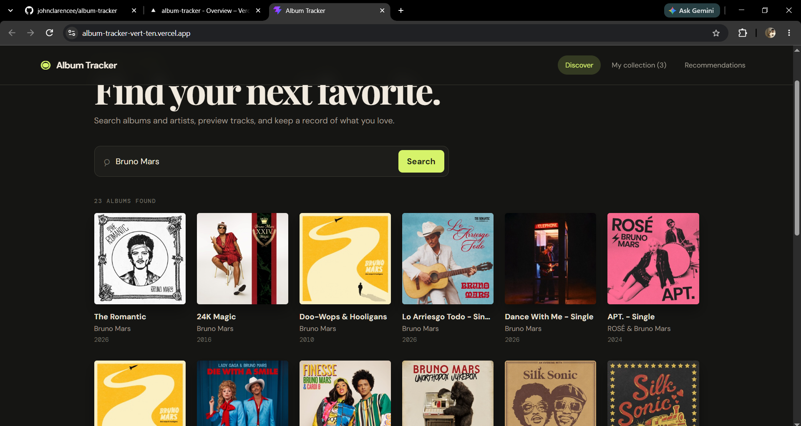
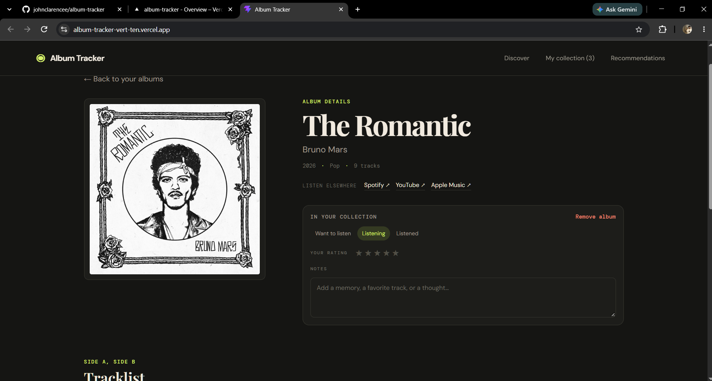
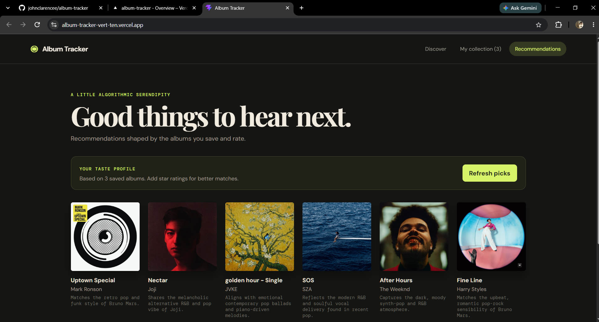

# Album Tracker

Album Tracker is a React app for discovering albums, previewing tracks, and keeping a personal listening log. It uses the iTunes Search API for album and track information, stores a collection in the browser, and can suggest new albums from the saved listening profile.

## Screenshots and live site

Live site: [https://album-tracker-vert-ten.vercel.app/](https://album-tracker-vert-ten.vercel.app/)
GitHub repository: [https://github.com/johnclarencee/album-tracker](https://github.com/johnclarencee/album-tracker)

### Discover search results

### Album detail

### Recommendations

## Features

- Search albums and artists through the iTunes Search API.
- View album artwork, release year, genre, and track list.
- Play available 30-second track previews with a persistent mini player.
- Save albums with a listening status, 1–5 star rating, and private notes.
- Filter and sort the local collection.
- Open a Deezer album widget when a confident catalog match is found.
- Request LLM-powered recommendations based on saved albums and ratings.

## Tech stack

React, Vite, Context API, iTunes Search API, Deezer widget/API, Google Gemini API, and Vercel serverless functions.

## How the app works

Discover and album detail pages get catalog data from `src/services/itunes.js`. Shared collection state lives in `CollectionContext` and is persisted by `useLocalStorage`; the separate `PlayerContext` owns one audio element so a preview continues while you navigate. The recommendations page sends only album titles, artists, ratings, and statuses to `/api/recommend`; that server-side function calls Gemini, then the page checks each suggestion against iTunes. The Deezer lookup follows the same browser-to-`/api/deezer` pattern before offering the embedded player.

## Run locally

1. Install Node.js 18 or newer.
2. Clone this repository and run `npm install` (`npm.cmd install` in PowerShell if its execution policy blocks `npm.ps1`).
3. Create `.env.local` in the project root and add `GEMINI_API_KEY=your-key-here` to enable AI recommendations. The key is optional while building the core app.
4. Run `npm run dev` (`npm.cmd run dev` in PowerShell if needed) and open the local URL printed in the terminal.

The Vite development config runs the `api/` serverless functions locally. Restart the dev server after changing `.env.local` or `vite.config.js`.

## Limitations

- iTunes provides 30-second previews, and some tracks have no preview.
- The collection is stored only in this browser's local storage.
- Full-album Deezer playback requires a Deezer login and may depend on Deezer's availability and account or regional limits.
- AI recommendations require a Gemini API key and an internet connection.
- Music metadata, artwork, and audio belong to their respective owners.

## AI privacy

When requesting recommendations, the app sends saved album titles, artists, ratings, and statuses to Google's Gemini API. Notes are not sent. The API key stays in a server-side environment variable and is not included in the React bundle.

The recommendation feature uses an LLM prompt and does not train a recommendation model.

## Disclaimer

This learning project is not affiliated with Apple, Spotify, Deezer, or Google.

## Reflection

1. **Why use `useRef` for the audio element?** I use `useRef` because the audio player should stay the same while pages change. I use state for things shown on screen, like the current song and progress.
2. **Why keep API calls in `services/`?** API code stays in one place, so it is easier to find and update. This also keeps the pages and components easier to read.
3. **Why keep the Gemini key out of React and GitHub?** Anyone can see code sent to the browser, so a key in React code could be copied. If I push the key to GitHub, someone else could use it, so the app keeps it on the server.
4. **Why is this an LLM prompt and not a trained model?** The app asks an existing LLM to suggest albums; it does not train a model. This is quick and can explain suggestions, but the LLM can name albums that are not real, so the app checks iTunes.
5. **What was the hardest bug and how was it fixed?** The hardest problem was a 503 error when Gemini was busy. I added retries so the app tries again before showing an error.

## Submission checklist

- [x] [GitHub repository](https://github.com/johnclarencee/album-tracker)
- [x] [Live Vercel site](https://album-tracker-vert-ten.vercel.app/)
- [x] Screenshot: search results
- [x] Screenshot: album page
- [x] Screenshot: recommendations
- [x] Confirm no API key is committed
- [x] Answer the five reflection questions in the lab manual
